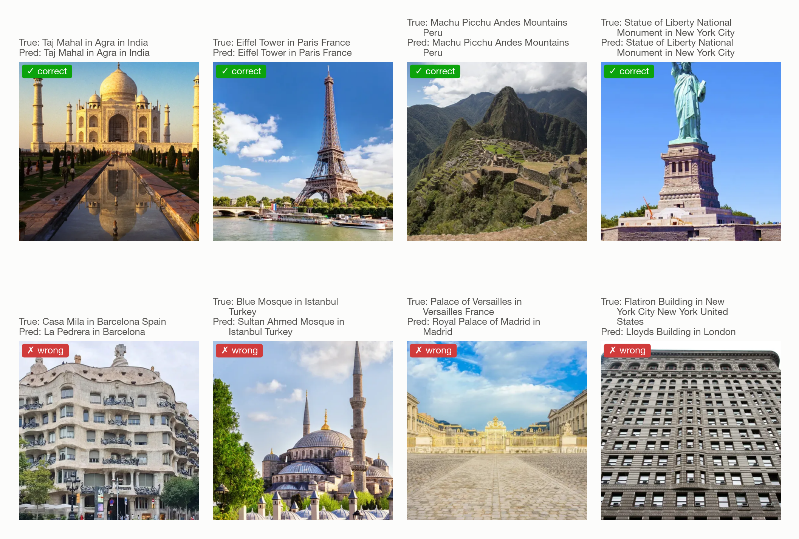
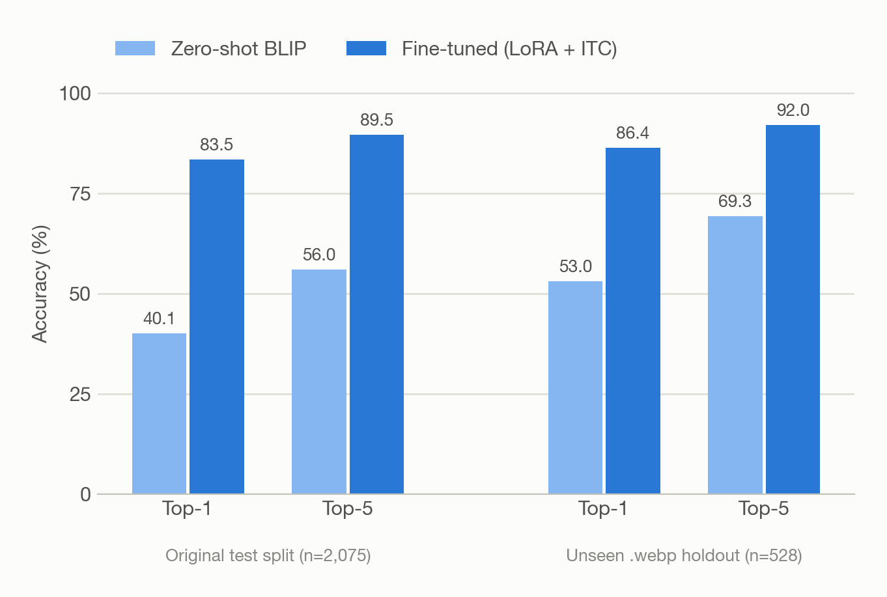
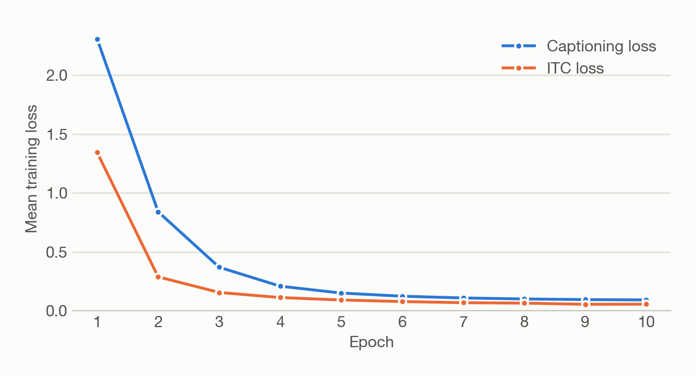
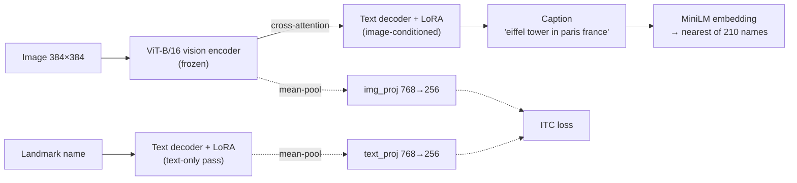
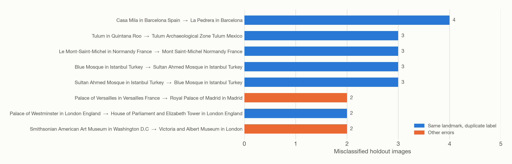

# Landmark Recognition with BLIP + LoRA

Fine-tuning Salesforce's [BLIP](https://arxiv.org/abs/2201.12086) image-captioning model to **name the landmark in a photo** across 210 world landmarks, using parameter-efficient LoRA adapters and an auxiliary image–text contrastive (ITC) loss. The project also audits the dataset for duplicate images and label aliases.


<picture>
  <source media="(prefers-color-scheme: dark)" srcset="assets/predictions_dark.png">
  
</picture>

## Highlights

- **Top-1 accuracy 53.0% → 86.4%** over zero-shot BLIP on 528 held-out images (Top-5 69.3% → 92.0%). Per-image predictions are included, so every number can be checked.
- **Consistent with the original training run:** 40.1% → 83.5% Top-1 on that run's 2,075-image test split (historical result, see [below](#evaluation-sets)).
- **Parameter-efficient:** 1.57M trainable parameters, of which 1.18M are LoRA weights (0.52% of BLIP) and 0.39M are projection heads; the vision encoder stays frozen.
- **Data-quality audit:** found 199 groups of identical files (88 spanning two labels), 6 landmarks stored under two names, and measured how much this affects the reported accuracy (very little).

## Results

<picture>
  <source media="(prefers-color-scheme: dark)" srcset="assets/accuracy_dark.png">
  
</picture>

| Model | Eval set | Images | Top-1 | Top-5 | Exact match |
|---|---|---:|---:|---:|---:|
| Zero-shot BLIP | Held-out `.webp` set | 528 | 53.0% | 69.3% | 0.0% |
| **Fine-tuned (LoRA + ITC)** | Held-out `.webp` set | 528 | **86.4%** | **92.0%** | **82.0%** |
| Zero-shot BLIP | Original test split *(historical)* | 2,075 | 40.1% | 56.0% | – |
| Fine-tuned (LoRA + ITC) | Original test split *(historical)* | 2,075 | 83.5% | 89.5% | – |

**How the metrics are computed.** The model generates a caption, a MiniLM sentence encoder embeds it, and the 210 landmark names are ranked by cosine similarity. Top-k means the true name is among the k closest; it is a retrieval ranking over generated text, not a softmax over classes. *Exact match* is stricter: the normalized caption must equal the landmark name. The zero-shot model never matches exactly. Its captions either add extra words ("tower bridge in london, england stock photo") or stay generic ("a cathedral in england").

### Evaluation sets

- **Held-out `.webp` set (primary).** 528 images that the training code's file filter (`.png/.jpg/.jpeg`) skipped. They cover 181 of the 210 labels and are scored against all 210 candidates. Being skipped by the filter does not guarantee the content is new: the [audit](#data-quality-audit) found 5 of them to be re-watermarked copies of `.jpg` images. Removing them, or all 79 near-duplicate candidates, moves the fine-tuned Top-1 by at most 0.3 points. They may also overlap with BLIP's web-scale pre-training data.
- **Original test split (historical).** These are the numbers logged on the GPU cluster where the model was trained. That split came from unsorted `os.listdir()` order and wasn't saved, so it can't be rebuilt. The code now sorts file lists, but `--split test` produces a *new* split that overlaps the released checkpoint's training images. Don't use it to evaluate that checkpoint.

<picture>
  <source media="(prefers-color-scheme: dark)" srcset="assets/training_curves_dark.png">
  
</picture>

## Method



- **Task framing.** Each image's target text is its landmark name, so recognition becomes caption generation followed by retrieval over the 210 names.
- **Frozen vision encoder.** The pre-trained ViT features are kept fixed, which limits overfitting with about 40 training images per class.
- **LoRA on the text decoder.** Rank-16 adapters on the `query`/`value` projections (self- and cross-attention) are the only BLIP weights that train.
- **Auxiliary ITC loss.** A symmetric InfoNCE loss (temperature 0.07) on mean-pooled image features and on the landmark name passed through the decoder *without* the image (dashed path). Total loss = captioning cross-entropy + 0.3 × ITC. No LoRA-only run was made, so this repo does not show whether ITC itself helps.

| Setting | Value |
|---|---|
| Data | 7,931 train / 2,075 test images (80/20 per class), 210 landmarks |
| Optimizer | AdamW, lr 5e-5, weight decay 0.01, 10% linear warm-up |
| Schedule | 10 epochs, batch size 8, gradient clipping 1.0 |
| Hardware | 1× Tesla V100 16 GB, ≈2 h for training + evaluation |

## Error analysis

<picture>
  <source media="(prefers-color-scheme: dark)" srcset="assets/error_breakdown_dark.png">
  
</picture>

The most frequent errors aren't recognition failures. The dataset stores some landmarks under two folder names, and the model picks the other one:

| Same landmark, two labels |
|---|
| Casa Milà ↔ La Pedrera |
| Blue Mosque ↔ Sultan Ahmed Mosque |
| Sagrada Família (×2) · Mont-Saint-Michel (×2) · Tulum (×2) |
| Palace of Westminster ↔ Houses of Parliament |

The alias list ([`results/label_aliases.json`](results/label_aliases.json)) uses a strict rule: two labels are merged only if they name the same physical landmark. Part-of relations such as *Big Ben* vs *Palace of Westminster* and *Parthenon* vs *Acropolis* are listed but not merged. The list was compiled after the model's errors had been reviewed, so the alias-aware score is supplementary analysis, not a headline result. Under it, 20 of the 72 held-out errors count as correct and Top-1 rises from 86.4% to 90.2%.

The remaining errors include similar-looking buildings (two Baroque palaces, two glass-roofed museum courtyards) and some label noise. For example, a photo of St Basil's Cathedral is filed under *Moscow Kremlin*.

## Data quality audit

[`src/audit_duplicates.py`](src/audit_duplicates.py) hashes all 10,534 images. Its output is in [`results/duplicate_audit.json`](results/duplicate_audit.json).

| Finding | Count |
|---|---:|
| Groups of byte-identical files | 199 (398 files) |
| …of which span two different labels | 88 |
| Test images with an identical copy in train (current sorted split) | 58 of 2,075 (33 same label, 25 other label) |
| Held-out images flagged as near-duplicate candidates | 79 of 528 |
| …confirmed by visual inspection as the same photo | 5 |

Shared files cluster in the alias pairs above (e.g. 30 identical files between the two Sagrada Família folders), plus *Acropolis/Parthenon* (8) and *Lincoln Memorial/Washington Monument* (4).

**Effect on the reported accuracy** (held-out set):

| Subset | Images | Zero-shot Top-1 | Fine-tuned Top-1 |
|---|---:|---:|---:|
| All | 528 | 53.0% | 86.4% |
| Without the 5 confirmed duplicates | 523 | 53.0% | 86.4% |
| Without all 79 candidates | 449 | 53.5% | 86.6% |

The near-duplicates do not inflate the result. A per-class random split still lets identical files cross between train and test, so a future retrain should split by duplicate group (see [Limitations](#limitations--future-work)).

## Quickstart

```bash
git clone https://github.com/snuuym/Blip-Based-Landmark-Recognition-Modeling.git
cd Blip-Based-Landmark-Recognition-Modeling
pip install -r requirements.txt
```

The included checkpoint (`checkpoints/`, 6.7 MB) contains the LoRA adapter, the projection heads and the 210 landmark names, so inference needs no dataset:

```bash
python src/predict.py my_photo.jpg --checkpoint checkpoints
# Output for the Eiffel Tower image in the figure above:
#   caption: eiffel tower in paris france
#   1. Eiffel Tower in Paris France
#   2. Tower of London in London
#   3. Notre Dame Cathedral Paris France
```

To evaluate, train or rebuild the figures, download the [Landmarks-210 dataset](https://www.kaggle.com/datasets/andreybeyn/qudata-gembed-landmarks-210) and place it so each landmark is a folder under `data/landmarks/`:

```bash
# Evaluate fine-tuned vs zero-shot on the held-out set (add --device cpu if MPS is unstable)
python src/evaluate.py --data-root data/landmarks --checkpoint checkpoints --split holdout --tag finetuned
python src/evaluate.py --data-root data/landmarks --split holdout --tag zeroshot

# Duplicate audit and README figures
python src/audit_duplicates.py --data-root data/landmarks
python src/make_figures.py --data-root data/landmarks

# Train (GPU recommended; see scripts/train.sbatch for SLURM)
python src/train.py --data-root data/landmarks --output-dir checkpoints
```

**Tested environments.** The checkpoint was trained on Python 3.11 with a V100 GPU (transformers 5.x, peft 0.19.1). Inference, evaluation and figures were verified on Python 3.13 on macOS CPU with the exact versions in `requirements.txt`.

## Project structure

```
├── src/
│   ├── data.py              # dataset split, PyTorch Dataset, label normalization
│   ├── model.py             # BLIP + LoRA setup, projection heads, ITC loss, loading
│   ├── train.py             # training loop (captioning + ITC)
│   ├── evaluate.py          # caption generation, Top-1/Top-5/exact-match metrics
│   ├── predict.py           # inference on your own images
│   ├── audit_duplicates.py  # duplicate / leakage audit
│   └── make_figures.py      # README figures and held-out summary
├── scripts/                 # SLURM job scripts used on the GPU cluster
├── checkpoints/             # LoRA adapter, projection heads, labels.json
├── results/                 # metrics, per-image predictions, audit, training log
└── assets/                  # figures (light and dark variants)
```

## Limitations & future work

**The released checkpoint was trained with the original single-file cluster script.** Tag [`v1.0-as-trained`](https://github.com/snuuym/Blip-Based-Landmark-Recognition-Modeling/tree/v1.0-as-trained) keeps that script's model, loss and target processing unchanged. It adds packaging into modules, sorted file ordering and a fixed `torch` seed, so it does not reproduce the original split or random state. Review after training found four issues, which are fixed on `main` but not yet reflected in the checkpoint:

- Label text was padded to 512 tokens, although names are at most 23. Now 32, which also makes training much faster.
- The ITC text embedding was a plain mean over all 512 positions, so padding dominated it. Now a mask-weighted mean over real tokens.
- Images of the same landmark in one batch were treated as ITC negatives (roughly 1 in 8 batches at batch size 8). They are now shared positives.
- Training targets kept the folder names' underscores, so raw captions read like `himeji _ castle`. Targets are now readable names. Evaluation normalizes both sides either way.

**Next steps:** merge alias labels, split train/validation/test by duplicate group, retrain with the fixed code, and compare zero-shot vs LoRA-only vs LoRA + ITC on the same fixed split. Further ablations: unfreezing the vision encoder, LoRA rank, and a CLIP linear-probe baseline. Recognition is limited to the 210 training landmarks.

## Acknowledgements

- Li et al., *BLIP: Bootstrapping Language-Image Pre-training for Unified Vision-Language Understanding and Generation*, ICML 2022. [arXiv:2201.12086](https://arxiv.org/abs/2201.12086)
- Hu et al., *LoRA: Low-Rank Adaptation of Large Language Models*, ICLR 2022. [arXiv:2106.09685](https://arxiv.org/abs/2106.09685)
- Dataset: [Landmarks-210 on Kaggle](https://www.kaggle.com/datasets/andreybeyn/qudata-gembed-landmarks-210)
- Started as the final project for STATS 507 at the University of Michigan.

## License

The code in this repository is released under the [MIT License](LICENSE) © 2026 Sunny Ma. The base model [Salesforce/blip-image-captioning-base](https://huggingface.co/Salesforce/blip-image-captioning-base) is distributed under BSD-3-Clause, and the released adapter is a derivative of it. The photos shown in `assets/` come from the Kaggle dataset; their copyright belongs to the original photographers and stock agencies, and they appear here only to illustrate model behaviour.
